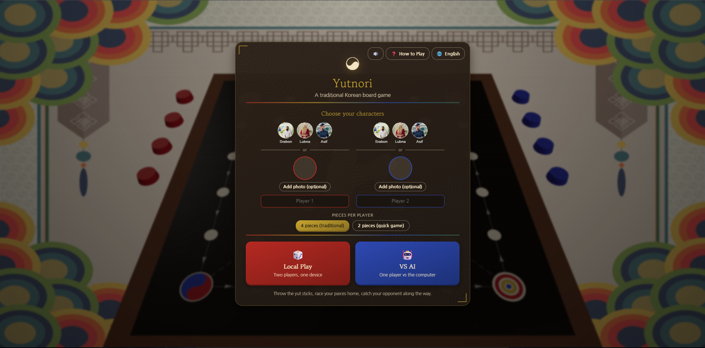
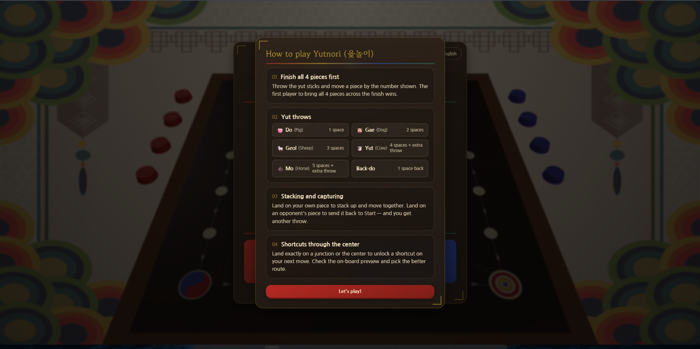
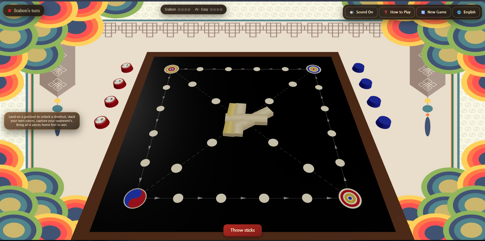
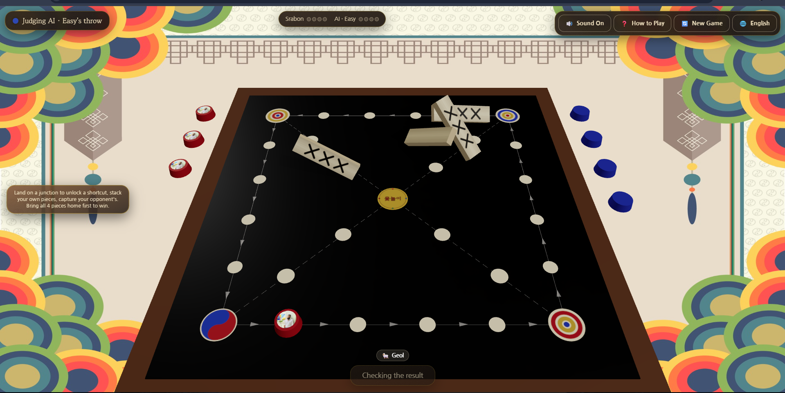

<div align="center">

# 🎲 Yutnori (윷놀이)

**A 3D, browser-based version of the traditional Korean board game.**
Throw the yut sticks, race your pieces around the board, catch your opponent, and cut through the center on a shortcut to get home first.

[](https://yutnori-ten.vercel.app/)


🌐 **English · 한국어 · বাংলা**

</div>

---

## 📑 Table of Contents

- [Overview](#-overview)
- [Live Demo](#-live-demo)
- [Screenshots](#-screenshots)
- [Features](#-features)
- [How to Play](#-how-to-play)
- [Tech Stack](#-tech-stack)
- [Getting Started](#-getting-started)
- [Project Structure](#-project-structure)
- [Author](#-author)

---

## 📖 Overview

Play locally with a friend on one device, or against a computer opponent. There are no installs, no accounts, and no backend. Just open it and play.

## 🔗 Live Demo

**▶️ [https://yutnori-ten.vercel.app](https://yutnori-ten.vercel.app/)**

---

## 📸 Screenshots

### Home Screen
Pick each player's character, choose 4 or 2 pieces per player, and start Local Play or VS AI, with the live 3D board visible behind the menu.



### How to Play
An in-game tutorial covering throws, stacking and capturing, and shortcuts through the center. It is available any time from the **How to Play** button.



### Gameplay
Take your turn and throw the sticks. The turn indicator, piece counters, and sound, language, and new game controls stay on screen.



### Yut Throw
Yut sticks toss and scatter across the board with a flip animation, and the result (here, **Geol**) is announced. The computer plays its entire turn on its own.



---

## ✨ Features

| Feature | Description |
| :--- | :--- |
| **Full rules engine** | Do/Gae/Geol/Yut/Mo throws, the hidden Back-do rule, Yut/Mo bonus throws, catching (sends a piece back to start plus a bonus throw), stacking (same-team pieces move together), both diagonal shortcuts through the center, and correct win detection. |
| **3D board & pieces** | Pieces animate step by step along the board path, including shortcuts, instead of teleporting. Yut sticks toss and scatter with a proper flip animation. |
| **Hover-to-preview** | Hover a move choice or shortcut option to see exactly where that piece would land, with a highlighted path, before committing. |
| **Home screen** | A landing menu with the live board behind it, where you pick each player's character, choose 4 or 2 pieces, and start either mode. |
| **Local pass-and-play** | Two players, one device. |
| **VS AI** | **Easy** (random moves), **Medium** (sensible heuristic play), or **Hard** (plays to win, always taking a catch or a finish when available). The computer throws, chooses moves, and resolves shortcut choices on its own. |
| **Character customization** | Upload your own photo and nickname, or pick from three pre-made characters. If a player skips setup, the game randomly assigns one of the remaining characters. |
| **Multi-language** | English, 한국어, and বাংলা, switchable anywhere via the 🌐 button, covering every screen including the tutorial and in-scene labels. |
| **Korean-styled presentation** | Taegeuk and obangsaek color palette, a hanji-paper panel texture, ornamental corner brackets on menus and modals, a Korean-lettered center emblem, synthesized sound effects (throws, catches, stacks, wins, and UI feedback), and a confetti victory effect. |
| **Responsive** | Playable on both desktop and mobile. |

---

## 🎮 How to Play

1. On the home screen, set up each player's character, choose 4 (traditional) or 2 (quick game) pieces per player, then pick **Local Play** or **VS AI** (choosing a difficulty first).
2. Throw the yut sticks each turn. The result moves a piece 1–5 spaces (or, rarely, 1 space backward via Back-do). Rolling Yut or Mo earns another throw before you have to move anything.
3. Land on your own piece to stack it. Land on an opponent's to send it back to start and earn a bonus throw. Landing exactly on a corner or the center lets you choose a shortcut route home.
4. The first player to bring all of their pieces home wins.

| Throw | Name | Move |
| :--- | :--- | :--- |
| Do (Pig) | 도 | 1 space |
| Gae (Dog) | 개 | 2 spaces |
| Geol (Sheep) | 걸 | 3 spaces |
| Yut (Cow) | 윷 | 4 spaces + extra throw |
| Mo (Horse) | 모 | 5 spaces + extra throw |
| Back-do | 빽도 | 1 space back |

The **❓ How to Play** button (on the home screen or in-game) reopens the full tutorial at any time.

---

## 🛠️ Tech Stack

| Technology | Purpose |
| :--- | :--- |
| [Vite](https://vitejs.dev/) + [React](https://react.dev/) + TypeScript | App framework and tooling |
| [react-three-fiber](https://docs.pmnd.rs/react-three-fiber) / [drei](https://github.com/pmndrs/drei) (Three.js) | 3D board and scene |
| [Zustand](https://github.com/pmndrs/zustand) | State management |
| [Vitest](https://vitest.dev/) | Rules-engine test suite |
| Web Audio | Synthesized sound effects, with no audio files |

---

## 🚀 Getting Started

```bash
npm install
npm run dev
```

Then open the printed local URL in your browser.

Other scripts:

```bash
npm run build   # type-check + production build
npm run preview # preview the production build
npm test        # run the unit test suite
```

---

## 🗂️ Project Structure

```
src/
  engine/   pure TypeScript rules engine (board graph, turn state machine, throws) — fully unit-tested
  ai/       VS AI: a pure heuristic move-picker plus the controller that drives it via the same
            store actions a human uses — the engine itself has no notion of "AI"
  scene/    the 3D board, pieces, yut sticks, and effects (react-three-fiber)
  ui/       2D overlay UI (home screen, turn indicator, move picker, modals, settings)
  store/    Zustand store wiring the engine to the UI/scene — also holds screen navigation,
            language, sound, and AI configuration
  audio/    synthesized sound effect playback
  i18n/     translation dictionaries (en/ko/bn) and the useT() hook
  styles/   global CSS and the shared Korean-themed visual style
```

The engine has no dependency on React or Three.js, so the rules can be tested and reasoned about in isolation from rendering.

---

## 👨‍💻 Author

- GitHub: [@Srabon-bot](https://github.com/Srabon-bot)
